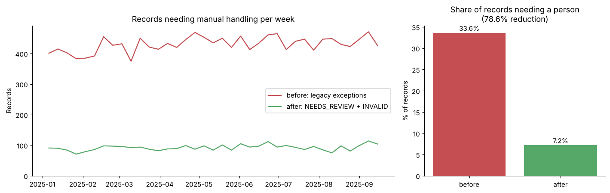
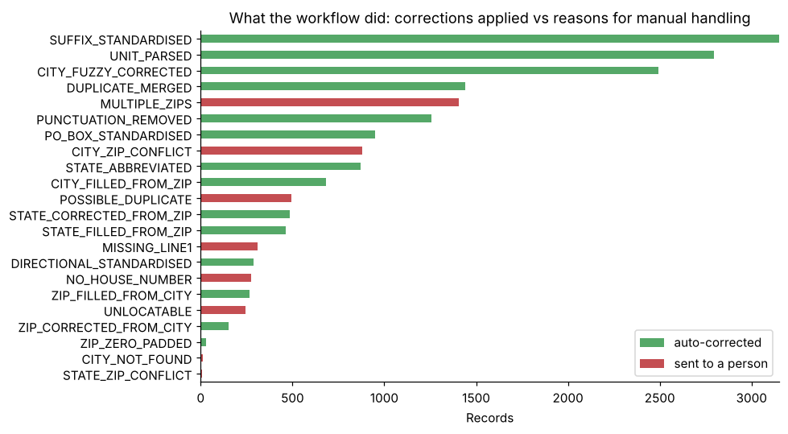
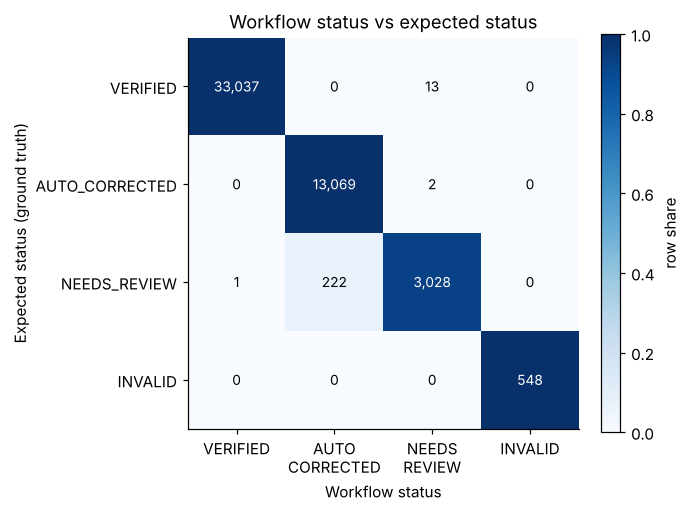

# Address Verification Workflow

A Python workflow that standardises, validates, corrects and de-duplicates patient mailing addresses against a ZIP
reference table, flags every record VERIFIED / AUTO_CORRECTED / NEEDS_REVIEW / INVALID with reasons, and writes a
prioritised exception queue for the records a person still has to look at.

## Business goal

Modelled on work I did for a healthtech startup, where an operations team checked patient addresses by hand before
letters, test kits and home-health visits went out. The goal was to cut that manual effort by letting software fix
everything that can be fixed deterministically and sending only genuine exceptions to a person. This project
rebuilds the approach on synthetic data and measures:

1. How many records the workflow can release without a person, and how often its decision is right.
2. How much manual review effort it removes compared with the old exact-match exception rules.
3. What the remaining exception queue looks like for the reviewers.

## Data

All data is synthetic and generated by `src/generate_data.py` (fixed seed). Patient names are random combinations
of common first and last names; cities and ZIP codes are made up (the leading ZIP digit follows the real regional
layout, nothing else does).

| File | Rows | Content |
|---|---|---|
| `data/raw/address_records.csv` | 49,920 | Raw patient address records (the workflow input) |
| `data/raw/zip_reference.csv` | 3,170 | Valid ZIP -> city, state (1,591 cities, 50 states plus DC) |
| `data/raw/address_ground_truth.csv` | 49,920 | Planted issues, expected status, true clean address, duplicate link (used only for scoring) |

`address_records.csv` schema:

| Column | Description |
|---|---|
| `record_id` | Record identifier (R000000 ...) |
| `first_name`, `last_name` | Fictional patient name |
| `address_line1`, `address_line2` | Street line and optional unit, as entered |
| `city`, `state`, `zip` | As entered (state may be spelled out, ZIP may be ZIP+4, 4-digit, or missing) |
| `source_system` | EHR_INTAKE, PATIENT_PORTAL, CALL_CENTER or PARTNER_FEED |
| `created_at` | Arrival timestamp (January to September 2025) |

How it is generated: each record starts as a clean, USPS-style address drawn from the reference table (3% are
household members sharing another record's address). Issues are then planted independently at fixed rates, so 34.6%
of records carry at least one: spelled-out or punctuated suffixes and directionals, units embedded in line 1, PO
boxes in five formats, spelled-out states, minor (1 edit) and heavy (3 or more edits) city typos, a different real
city, missing city / state / ZIP / street line, wrong state, transposed ZIP digits, ZIPs that lost a leading zero,
missing house numbers, exact re-submissions (3%) and re-submissions with a name typo (1%). The ground truth records
the status the review policy expects for each record.

## Approach

1. **Data profiling** (`notebooks/01_data_profiling.ipynb`): completeness, format patterns (ZIP, state, street
   suffix, PO box, units), agreement with the ZIP reference, city similarity distribution, duplicates.
2. **Workflow run and accuracy** (`02_workflow_run_and_accuracy.ipynb`): run `src/workflow.py` on all records:
   * standardise (`src/standardize.py`): case, whitespace, USPS suffixes and directionals, unit parsing, PO box
     format, state names to codes, ZIP+4 split, restore lost leading zeros;
   * validate against the reference (missing fields, unknown ZIP, city or state disagreeing with the ZIP, missing
     house number);
   * correct: fill city/state from the ZIP, correct the state when the city agrees with the ZIP, fuzzy-match city
     typos with `difflib` (ratio of 0.8 or more with a clear winner), fill the ZIP when the city has only one;
   * de-duplicate: exact (same person and standardised address, merged into the earliest record) and possible
     (same address, name similarity of 0.85 or more);
   * flag the status with reasons. Then score rule-level results, status accuracy and field-level correctness of
     released records against the planted ground truth.
3. **Effort analysis** (`03_effort_analysis.ipynb`): share of records needing a person under the legacy exact-match
   exception rules vs after the workflow, analyst hours with a sensitivity grid, weekly workload, by source system.
4. **Exception queue** (`04_exception_queue.ipynb`): prioritise NEEDS_REVIEW and INVALID records (P1 to P4) with a
   recommended action and suggested fix, write `data/processed/exception_queue.csv`, and check how often the
   suggestion already holds the right answer.

## Results

| Metric | Value |
|---|---|
| Records processed | 49,920 in about 5 seconds |
| Status mix | 66.2% VERIFIED, 26.6% AUTO_CORRECTED, 6.1% NEEDS_REVIEW, 1.1% INVALID |
| Status accuracy vs planted ground truth | 99.52% |
| Released records (VERIFIED + AUTO_CORRECTED) with all five fields correct | 46,328 of 46,329 (99.998%) |
| Records needing a person: legacy rules vs workflow | 33.6% vs 7.2%, **78.6% fewer** |
| Manual effort in analyst hours (with outreach and QA sampling) | 1,173 h vs 305 h, **74.0% less** (70.6% to 76.9% across assumptions) |
| Exception queue | 3,591 records: 548 P1, 877 P2, 1,670 P3, 496 P4 |







Notes on the results:

* The two effort numbers answer different questions: 78.6% fewer records reach a person, and 74.0% fewer analyst
  hours once INVALID outreach and QA spot-checks of auto-corrections are counted.
* The main disagreement with the review policy is 222 heavy city typos that the policy sends to review but the
  fuzzy matcher resolved; all 222 were corrected to the right address, so the cutoff could be relaxed further.
* 16 household members with similar names were flagged as possible duplicates (false positives that cost a review).

## Repository structure

```
address-verification-workflow/
  data/
    raw/
      address_records.csv        workflow input
      zip_reference.csv          synthetic ZIP -> city, state reference
      address_ground_truth.csv   planted issues and expected status (scoring only)
    processed/
      workflow_results.csv       status, reasons and final address per record
      exception_queue.csv        prioritised review queue
      status_summary.csv, effort_summary.csv
  notebooks/
    01_data_profiling.ipynb
    02_workflow_run_and_accuracy.ipynb
    03_effort_analysis.ipynb
    04_exception_queue.ipynb
  reports/figures/               charts used in this README
  src/
    generate_data.py             synthetic data generator
    reference.py                 state codes, suffix / directional / unit vocabularies, reference loader
    standardize.py               field standardisation
    workflow.py                  validation, correction, de-duplication, status flagging, legacy rules
```

## How to reproduce

```bash
pip install -r requirements.txt
python src/generate_data.py
cd notebooks
jupyter nbconvert --to notebook --execute --inplace 01_data_profiling.ipynb 02_workflow_run_and_accuracy.ipynb 03_effort_analysis.ipynb 04_exception_queue.ipynb
```

Run the notebooks in order: 03 and 04 read `data/processed/workflow_results.csv` written by 02. Each notebook runs in
under 15 seconds. `python src/generate_data.py --n 200000` generates a larger file (about four times the size).

## Tech stack

Python, pandas, NumPy, difflib (fuzzy city matching), scikit-learn (classification metrics), matplotlib, Jupyter.

## Note on data

All data in this repository is synthetic. Names, addresses, cities and ZIP codes are fictional and were generated to
mirror the kinds of problems seen in real intake data; no patient or customer data from the engagement is included.
The numbers above are what this code produces on the synthetic data, not results from the client engagement.
